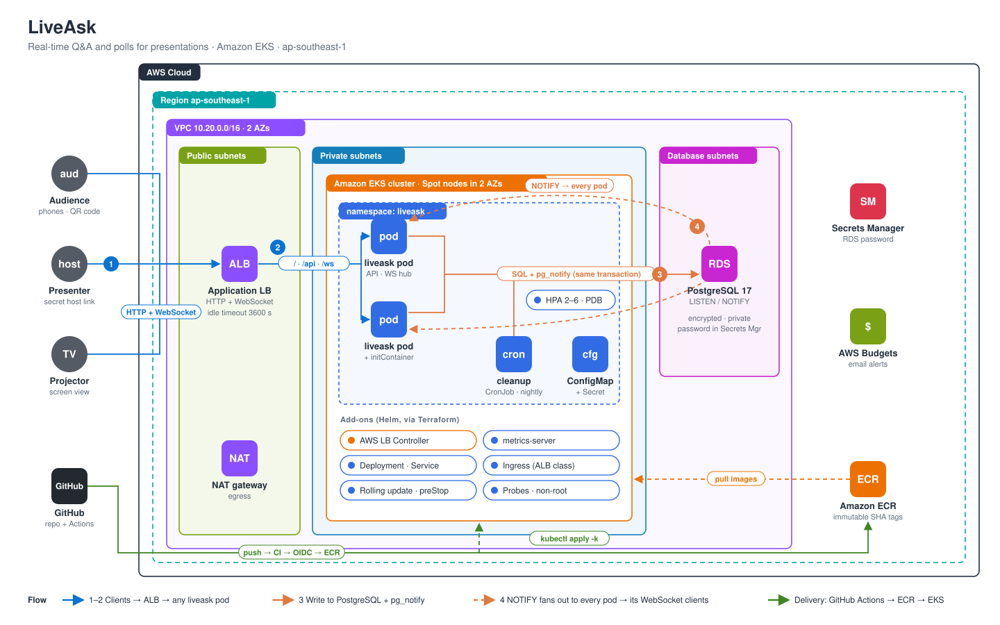
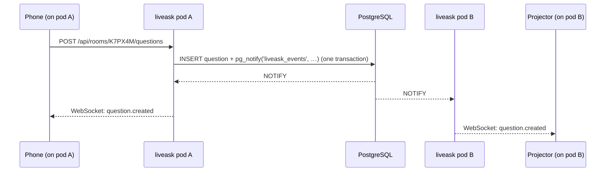

# Architecture

## 1. Overview



_The diagram is generated by [`docs/images/make_architecture.py`](docs/images/make_architecture.py); edit it and run `python docs/images/make_architecture.py` to regenerate._

**Request path:** phones, presenter laptop and projector → **ALB** (public subnets; HTTP and WebSocket) → **liveask pods** on EKS (private subnets; 2–6 replicas) → **RDS PostgreSQL** (database subnets, no internet route).

**Real-time path:** a write (new question, vote, poll) is saved in Postgres and in the same transaction fires `pg_notify`. **Every** pod is listening, so each one pushes the event to the WebSocket clients connected to it. That is how a phone on pod A sees a question posted through pod B.

## 2. The multi-pod problem (key design point)



| Option | Why not chosen (for now) |
|---|---|
| Sticky sessions only | All clients of one room would need to land on the same pod; breaks when that pod restarts or the HPA adds pods |
| Redis pub/sub | Works well, but adds a component to run and pay for. Kept as a roadmap item (D-004) |
| **Postgres `LISTEN/NOTIFY`** ✅ | Already have Postgres; notifications fire only after commit; enough for hundreds of clients |

## 3. Zero-downtime rolling update

1. The Deployment uses `maxUnavailable: 0, maxSurge: 1`: a new pod must be **Ready** before an old one stops.
2. The new pod's **initContainer** runs migrations (idempotent, under an advisory lock).
3. The old pod gets `SIGTERM`. Its **preStop** hook sleeps ~10 s so the ALB stops sending new connections (deregistration delay 30 s). `/readyz` returns 503 while shutting down.
4. The app closes its WebSockets with code **1012**; clients reconnect (backoff) to a healthy pod and resync with `GET /api/rooms/{code}`.
5. `terminationGracePeriodSeconds: 45` leaves room for all of this.

## 4. Kubernetes objects

| Object | Name | Purpose |
|---|---|---|
| Namespace | `liveask` | Isolates the app from add-ons |
| Deployment | `liveask` | API + WebSocket + static pages; 2+ replicas, topology spread across AZs, non-root, read-only root FS, probes, preStop |
| initContainer | `migrate` | Applies `schema.sql` before the app container starts |
| Service | `liveask` | Stable in-cluster address for the pods |
| Ingress | `liveask` | AWS: ALB (target-type `ip`, idle timeout 3600 s for WebSockets, deregistration delay 30 s). Local: ingress-nginx addon |
| ConfigMap | `liveask-config` | Room limits, rate limits, log level |
| Secret | `liveask-db` | `DATABASE_URL`. Local: Kustomize `secretGenerator` with throwaway creds. AWS: created from Secrets Manager by `scripts/create-db-secret.sh` |
| HPA | `liveask` | CPU 60%, 2–6 replicas (needs metrics-server) |
| PodDisruptionBudget | `liveask` | `minAvailable: 1` during node drains / Spot interruptions |
| CronJob | `liveask-cleanup` | Nightly delete of expired rooms; `concurrencyPolicy: Forbid` |
| StatefulSet + headless Service + PVC | `postgres` | **Local overlay only:** Postgres with persistent storage. On AWS, RDS replaces it |

## 5. AWS resources (Terraform, `infra/terraform/`)

Already written and validated (see `CURRENT_STATE.md`): VPC (2 AZs: public, private and database subnets, one NAT gateway), EKS (managed Spot node group, access entries), AWS Load Balancer Controller (IRSA), metrics-server, ECR, RDS PostgreSQL (password in Secrets Manager), GitHub OIDC deploy role, AWS Budgets. Day 3 changes: database name/user to `liveask`, and Kubernetes namespace `liveask` in the deploy role's access entry.

## 6. Repository layout (target after day 2)

```
app/
  liveask/
    main.py          FastAPI app, routes, static files
    config.py        settings from env vars
    db.py            psycopg connection pool
    hub.py           WebSocket hub + LISTEN connection
    migrate.py       applies schema.sql under an advisory lock
    cleanup.py       deletes expired rooms (CronJob entry point)
    schema.sql
    static/          index.html, audience.html, host.html, screen.html, app.js, styles.css
  tests/
  Dockerfile, requirements*.txt
k8s/
  base/              namespace, configmap, deployment, service, hpa, pdb, cronjob
  overlays/local/    postgres StatefulSet, secretGenerator, nginx ingress, HPA min 1
  overlays/aws/      ALB ingress
infra/terraform/     unchanged layout
scripts/             create-db-secret.sh, load_test.py, rolling-update-demo.sh
docs/images/         architecture.svg (+ generator), screenshots
.github/workflows/   ci.yml, deploy.yml
```

## 7. Tech stack

Python 3.13, FastAPI, Uvicorn, psycopg 3 (async, pool), plain HTML/CSS/JS (no build step), pytest; Docker; Kubernetes 1.35 on EKS / minikube; Kustomize; Terraform (terraform-aws-modules); GitHub Actions with OIDC; PostgreSQL 17.
