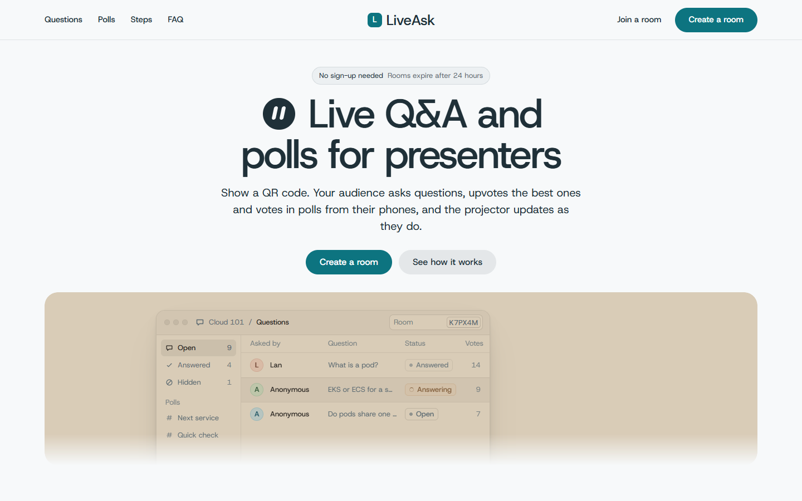
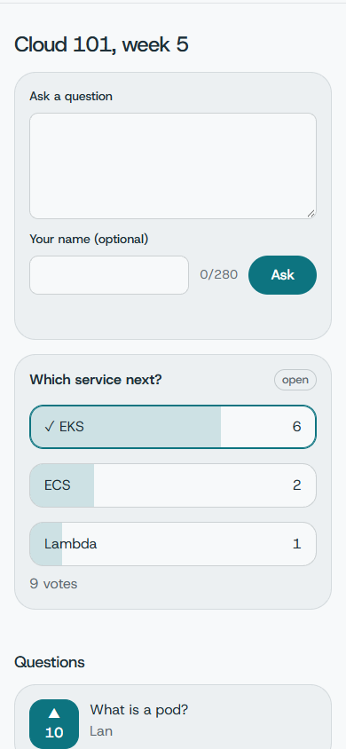
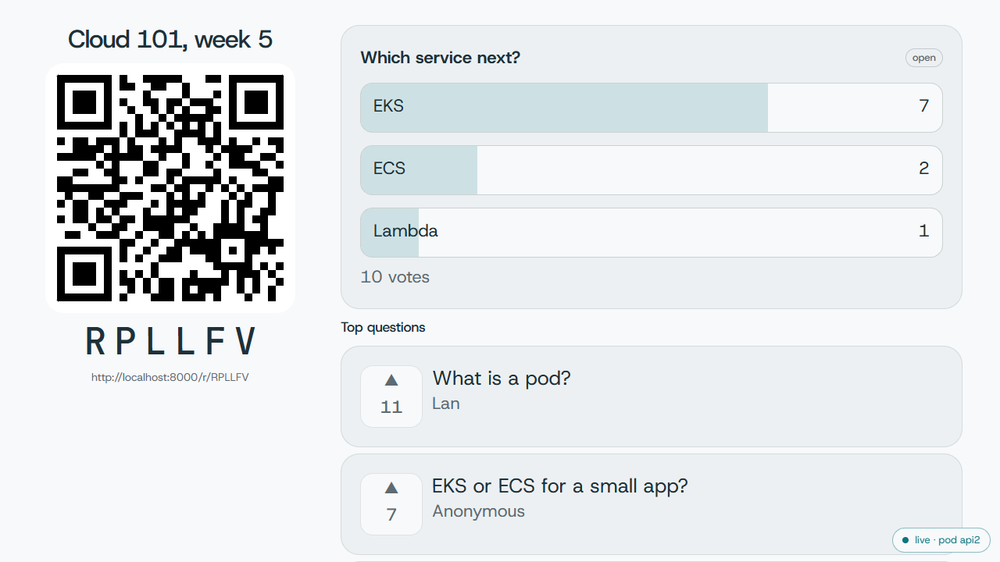
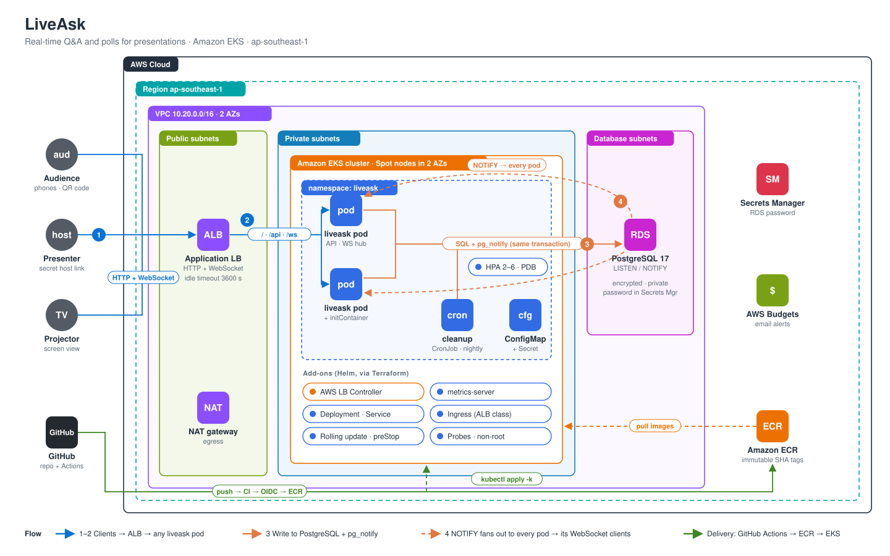

# LiveAsk

**Real-time Q&A and polls for presentations, running on Kubernetes (Amazon EKS).**

The presenter shows a QR code. The audience asks and upvotes questions and answers polls from their phones, with no sign-up. The presenter's page and the projector screen update live over WebSockets, whichever Kubernetes pod each person happens to be connected to.

> **Status (2026-11-22).** The app, the Kubernetes manifests and the redesigned UI are built and verified locally (Docker Compose and minikube) **and on Amazon EKS** in one session of about 50 minutes, which was destroyed afterwards: no AWS resources are left. Not done yet: a check from a real phone on mobile data, and screenshots of the AWS console. Plan: [`TASKS.md`](TASKS.md) · Current state: [`CURRENT_STATE.md`](CURRENT_STATE.md) · EKS session: [`docs/eks-session-2026-11-22.md`](docs/eks-session-2026-11-22.md).

| Landing page | Audience (phone) | Projector |
|---|---|---|
|  |  |  |

The presenter's page: [`docs/images/host-1280.png`](docs/images/host-1280.png). The phone view also has a dark mode: [`docs/images/audience-390-dark.png`](docs/images/audience-390-dark.png).



## Why it runs on Kubernetes (and not Lambda)

Live updates need **WebSocket connections that stay open for the whole talk**, from many phones at once. That suits a container that keeps connections in memory. My other project, the Say Coffee website, is serverless because its traffic is light and bursty. LiveAsk is on EKS because of its long-lived connections. I picked the platform for the workload.

## The interesting problem: real time across several pods

With 2 to 6 replicas, a phone connected to **pod A** posts a question, but the projector is connected to **pod B**. LiveAsk saves the question and calls `pg_notify` **in the same PostgreSQL transaction**. Every pod `LISTEN`s, so every pod pushes the event to its own WebSocket clients. No sticky sessions, no extra Redis. Details and trade-offs: [`ARCHITECTURE.md`](ARCHITECTURE.md).

## What is verified (and how)

Everything below was run, not just written. Numbers are from 2026-11-21 and 2026-11-22: the local ones on a Windows 11 laptop, the EKS ones through a real Application Load Balancer.

| Claim | Evidence |
|---|---|
| The app works | 95 `pytest` tests against a real PostgreSQL; `ruff` clean |
| A write on one process reaches a WebSocket on another | A test starts two real app processes on one database (`app/tests/test_realtime.py`) |
| Host, phones and projector update each other across containers | `e2e/run.js`: 19 browser checks through nginx on Docker Compose, and the same 19 on minikube behind ingress-nginx, with the host and the screen on **different pods** |
| A restarted container does not lose data or the screen | `e2e/reconnect.js`: the screen shows "reconnecting", moves to the other container and shows the question it missed |
| **Zero-downtime rolling update** (NFR-2) | `e2e/rollout.js` on minikube: during `kubectl rollout restart`, 32 of 32 questions stored, the Deployment never below 2 available replicas, and the open screen reconnected on its own to a new pod and caught up |
| **Autoscaling** (NFR-4) | `scripts/load_test.py` with CPU load on minikube: CPU reached 345% of the 60% target and the HPA scaled **2 to 4 to 6 pods** in about 40 s |
| 200 clients, nothing lost (minikube) | 200 WebSocket clients spread over 6 pods (32 to 35 each); 18,400 of 18,400 expected deliveries arrived. Latency tail: p95 about 1.1 s, but the POST alone took a median 290 ms through a Windows Docker tunnel, so this was not a clean verdict on the 1 s target (NFR-1) |
| **On EKS: the same checks** | Through the ALB: `e2e/run.js` 19 of 19 with the host and the screen on different pods; `e2e/rollout.js` 6 of 6 (12 of 12 questions stored, 0 failed requests, never below 2 replicas, a 10 s rollout, the screen reconnected to a new pod and caught up) |
| **Latency target (NFR-1) on EKS** | 200 WebSocket clients over 2 pods (101 and 99): 22,600 of 22,600 deliveries, median 235 ms, **p95 733 ms** (target: under 1 s). This is one 60-second run, so it is one measurement, not a guarantee |
| **Autoscaling on EKS** | The HPA went from 2 to 6 pods (its maximum) at CPU 624% of the 60% target; all 6 targets in the ALB target group were healthy; pods were spread over 2 nodes in 2 availability zones |
| Data survives the database pod | Deleted `postgres-0` on minikube; the room was still there (StatefulSet and PVC) |
| Nightly cleanup works | Ran the CronJob by hand: "removed 1 expired room" |
| Accessibility basics | `e2e/a11y.js`: four pages, light and dark, at 320 px: no sideways scroll, 44 px targets, labelled fields, alt text |
| No data leaves the site | `e2e/run.js` fails if any page requests another origin; fonts and the QR generator are self-hosted |

GitHub CI is green (app tests with Postgres and the image build, manifest rendering, Terraform `fmt` and `validate`). Not verified yet: a real phone on mobile data, HTTPS, and a longer or heavier load run than 60 seconds.

## Kubernetes features used

| Object | Used for |
|---|---|
| Deployment (2+ replicas, spread across AZs) | API + WebSocket hub + pages; rolling updates with `maxUnavailable: 0`, `preStop` sleep and a 45 s grace period |
| initContainer `migrate` | Database migrations under a Postgres advisory lock (same image as the app) |
| Service + Ingress | minikube: ingress-nginx. AWS: ALB (target type `ip`, idle timeout 3600 s, deregistration delay 30 s, `/readyz` health check) |
| ConfigMap / Secret | Limits and settings / the database URL |
| Liveness + readiness probes | Liveness never touches the database; readiness needs the database and the LISTEN connection and is 503 while shutting down |
| HorizontalPodAutoscaler + metrics-server | 2 to 6 pods on CPU (demonstrated, see above) |
| PodDisruptionBudget | Keep a pod serving during node drains and Spot interruptions |
| CronJob `liveask-cleanup` | Nightly cleanup of rooms older than 24 hours (`concurrencyPolicy: Forbid`) |
| StatefulSet + headless Service + PVC (local only) | PostgreSQL with persistent storage on minikube; RDS on AWS |
| Namespace, security context | Non-root, read-only filesystem, no capabilities, seccomp, no service account token |

## AWS (applied once, then destroyed)

Terraform (`infra/terraform/`): VPC across 2 AZs (public, private and isolated database subnets, one NAT gateway), **EKS** (Kubernetes 1.35) with Spot managed nodes and access entries, **AWS Load Balancer Controller** (IRSA), **RDS PostgreSQL** (password in Secrets Manager), **ECR**, **GitHub Actions OIDC** deploy role (no AWS keys in GitHub) and **AWS Budgets** alerts. All of it was applied on 2026-11-22 (78 resources), used for the checks above and destroyed; a search of the account afterwards found nothing left.

**Cost of the session:** about 50 minutes of running time. At the published rate of about USD 0.27 per hour that is roughly USD 0.25; the actual bill is checked in Cost Explorer the next day (see [`SECURITY_AND_COST.md`](SECURITY_AND_COST.md)). Left running for a month the same stack would cost about USD 190, which is why the session always ends with the teardown.

**What went wrong, and the fix:** the first `apply` failed because `ap-southeast-1` lists a Local Zone first and a Local Zone has no NAT gateway (the VPC now uses standard zones only). The deploy role did not trust the GitHub token until the trust policy used the repository's immutable OIDC subject. And a GitHub-hosted runner cannot reach a Kubernetes API locked to one IP, so the workflow pushes the image and a script applies the manifests from the laptop. Details: [`docs/eks-session-2026-11-22.md`](docs/eks-session-2026-11-22.md).

## What this project shows

- **Platform choice by workload:** containers on EKS for long-lived WebSocket connections, serverless for the light, bursty site (Say Coffee).
- **Multi-pod real time without sticky sessions or Redis:** PostgreSQL `LISTEN/NOTIFY` fired in the same transaction as the write, proven by a test with two real processes and by browser checks across pods.
- **Operations evidence, not claims:** a rolling update with no lost data, HPA scaling from 2 to 6 pods, a nightly cleanup CronJob and a database that survives its pod, each run and measured, on minikube and again on EKS.
- **Infrastructure as code with no long-lived keys:** the whole AWS stack in Terraform, deployed through GitHub OIDC, created and destroyed in one short, cost-capped session.
- **Honest limits:** one 60-second load run, no phone-on-mobile-data check yet, HTTP only, and room creation is not rate-limited yet.

## Run it

On a new computer: [`RESUME.md`](RESUME.md) has the install list, the checks to run and the AWS steps.

```powershell
# 1. Docker Compose: Postgres + two app containers behind nginx (like two pods behind a load balancer)
docker compose up --build            # then open http://localhost:8000 in several tabs

# 2. Kubernetes on your machine (minikube)
minikube start -p eks-lab --driver=docker --memory=3072 --cpus=2 --addons=metrics-server,ingress
minikube image build -p eks-lab -t liveask:local app
kubectl apply -k k8s/overlays/local
minikube tunnel -p eks-lab           # keep it running; the app is then on http://127.0.0.1

# 3. Tests
cd app; ..\.venv\Scripts\python -m pytest -q        # needs Postgres: docker compose up -d db
cd e2e; npm install; npm run all                    # browser checks against Compose
scripts/rolling-update-demo.sh                      # zero-downtime update on minikube
```

AWS (one session, always ending with the teardown): `terraform apply`, `scripts/create-db-secret.sh`, then GitHub Actions "Deploy to EKS" (builds and pushes the image) and `bash scripts/deploy-from-laptop.sh` (applies the manifests from your laptop, because the Kubernetes API is locked to your IP). Teardown: `kubectl delete -k k8s/overlays/aws`, wait for the ALB to disappear, then `terraform destroy`.

## The UI

The landing page was designed and checked with the taste-skill design system (palette, type, a software-page layout, a real-browser checker and a finish gate); the audience, host and projector views use the same design tokens but not its marketing-page rules. Decisions D-016 to D-018, the plan and what the gate changed: [`docs/ui/DESIGN_PLAN.md`](docs/ui/DESIGN_PLAN.md). Fonts are self-hosted and the vendored kit is unmodified and checksum-guarded ([`docs/ui/KIT.md`](docs/ui/KIT.md)).

## Roadmap

HTTPS on a custom domain · Cognito sign-in for presenters · NetworkPolicies · Argo CD (GitOps) · Prometheus/Grafana and autoscaling on connection count (KEDA) · Redis pub/sub comparison · separate staging/prod · a Vietnamese-capable typeface if Vietnamese questions matter.

## Docs

[`PROJECT_REQUIREMENTS.md`](PROJECT_REQUIREMENTS.md) · [`ARCHITECTURE.md`](ARCHITECTURE.md) · [`DATABASE_DESIGN.md`](DATABASE_DESIGN.md) · [`API_SPECIFICATION.md`](API_SPECIFICATION.md) · [`SECURITY_AND_COST.md`](SECURITY_AND_COST.md) · [`DECISIONS.md`](DECISIONS.md) · [`TASKS.md`](TASKS.md)
